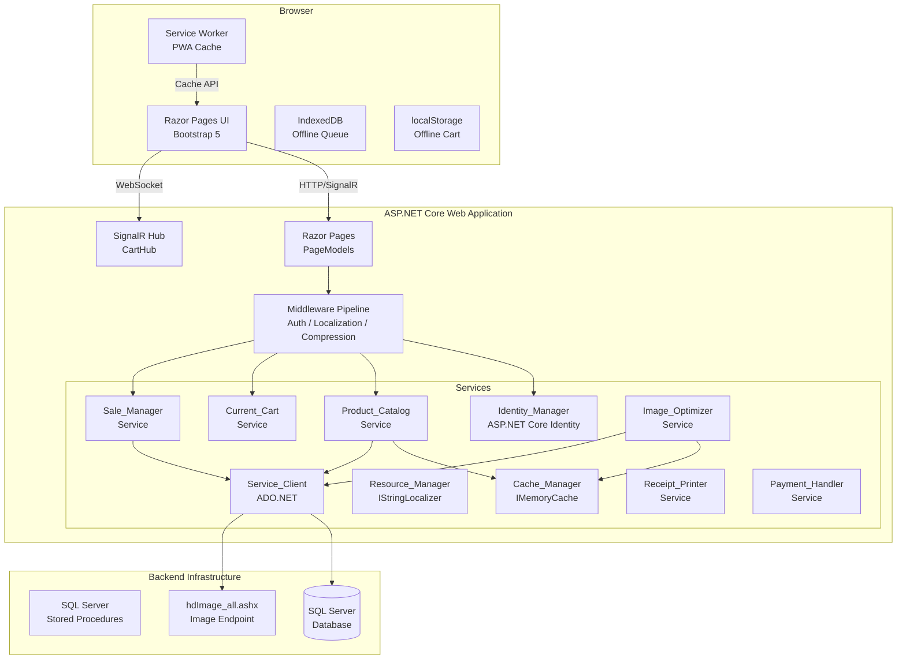
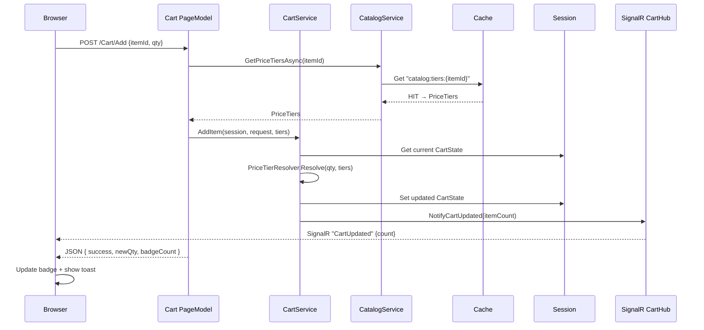

# Design Document: .NET Core POS Web Application

## Overview

This document describes the technical design for a .NET Core 6.0+ ASP.NET Core Razor Pages web application that replaces the Flutter mobile POS app with a browser-based Point of Sale experience. The application targets staff users (cashiers, sales staff, managers) and integrates directly with an existing SQL Server database via stored procedures using ADO.NET.

The system is organized around a server-side rendering model using Razor Pages with selective AJAX for real-time interactions (cart badge, quantity updates). A SignalR hub provides real-time cart feedback, and a Progressive Web App layer adds offline capability via service workers.

### Key Design Decisions

- **Razor Pages over MVC**: Razor Pages co-locates page logic with its view, reducing ceremony for this CRUD-heavy application. Each page is self-contained with its `PageModel` class.
- **Session-based cart**: The cart lives in ASP.NET Core distributed session keyed by staff session ID. This avoids database writes for in-progress orders and keeps the server stateless enough to run behind a load balancer with sticky sessions or Redis session backing.
- **Stored procedure data access**: All data operations (reads and writes) are performed via `Service_Client` calling SQL Server stored procedures using ADO.NET. The POS_Web_App connects directly to SQL Server.
- **Cache-first product catalog**: All catalog data (categories, groups, items, price tiers) is served from `IMemoryCache` (or Redis in multi-server scenarios) with a 1-hour sliding expiration, falling back to stored procedure calls via Service_Client on miss.

---

## Architecture

### High-Level Architecture Diagram



### Middleware Pipeline Order

```
UseExceptionHandler → UseHsts → UseHttpsRedirection →
UseStaticFiles → UseRouting → UseRequestLocalization →
UseAuthentication → UseAuthorization → UseSession →
UseResponseCompression → MapRazorPages → MapHub("/cartHub")
```

### Project Structure

```
PosWebApp/
├── Pages/
│   ├── Shared/
│   │   ├── _Layout.cshtml          # Master layout (navbar, footer)
│   │   ├── _NavbarPartial.cshtml   # Navigation with cart badge
│   │   ├── _CartItemPartial.cshtml # Single cart row
│   │   ├── _ItemCardPartial.cshtml # Product card (category/group/item)
│   │   └── _ItemDetailModal.cshtml # Item detail Bootstrap modal
│   ├── Account/
│   │   ├── Login.cshtml / .cs      # Staff login
│   │   └── Logout.cshtml / .cs     # Logout POST handler
│   ├── Index.cshtml / .cs          # Home: category browsing
│   ├── Groups.cshtml / .cs         # Group listing for a category
│   ├── Items.cshtml / .cs          # Item listing for a category/group
│   ├── Cart.cshtml / .cs           # Cart view and management
│   ├── Checkout.cshtml / .cs       # Checkout / sale confirmation
│   ├── Sale/
│   │   ├── Index.cshtml / .cs      # Sale history list
│   │   └── Detail.cshtml / .cs     # Single sale detail
│   ├── Search.cshtml / .cs         # Search results
│   ├── Reports/
│   │   └── EndOfDay.cshtml / .cs   # End-of-day report
│   ├── Error.cshtml / .cs          # Global error page
│   └── Privacy.cshtml
├── Hubs/
│   └── CartHub.cs                  # SignalR hub
├── Services/
│   ├── IProductCatalogService.cs
│   ├── ProductCatalogService.cs
│   ├── ICartService.cs
│   ├── CartService.cs
│   ├── ISaleManagerService.cs
│   ├── SaleManagerService.cs
│   ├── IImageOptimizerService.cs
│   ├── ImageOptimizerService.cs
│   ├── IServiceClient.cs
│   ├── SqlServiceClient.cs
│   ├── IPaymentHandlerService.cs
│   ├── PaymentHandlerService.cs
│   └── IReceiptPrinterService.cs
│   └── ReceiptPrinterService.cs
├── Models/
│   ├── ViewModels/                 # Page-specific view models
│   └── DTOs/                       # Data transfer objects (stored procedure results)
├── Infrastructure/
│   ├── CacheKeys.cs
│   ├── SessionExtensions.cs        # Typed session helpers
│   ├── PriceTierResolver.cs        # Price tier selection logic
│   ├── CurrencyFormatter.cs        # USD/KHR formatting
│   └── Exceptions/
│       └── ServiceException.cs
├── TagHelpers/
│   └── ImageTagHelper.cs           # Optimized image rendering
├── wwwroot/
│   ├── css/
│   ├── js/
│   │   ├── site.js
│   │   ├── cart.js                 # Cart AJAX + offline localStorage
│   │   └── sw.js                   # Service worker
│   ├── images/
│   │   └── placeholder.png
│   └── manifest.webmanifest
├── Resources/
│   ├── SharedResource.en-US.resx
│   └── SharedResource.km-KH.resx
├── Program.cs
└── appsettings.json
```

---

## Components and Interfaces

### Identity_Manager

Implemented via ASP.NET Core cookie authentication. On login, the `Identity_Manager` calls `IServiceClient.LoginAsync(username, password)`, which calls the sp_Login stored procedure via Service_Client. On success the response contains `UserID`, `UserLevel`, and `FullName`. Claims are populated directly from the login response. Lockout tracking (failed attempts, lockout state) is delegated to the Backend_Service — the POS_Web_App reads the lockout status from the login response and surfaces the appropriate message.

```csharp
// Login handler in Account/Login.cshtml.cs
var result = await _serviceClient.LoginAsync(Input.UserName, Input.Password);
if (result.IsLockedOut)
{
    ModelState.AddModelError("", "Your user account has been locked! Please contact IT");
    return Page();
}
if (!result.IsSuccess)
{
    ModelState.AddModelError("", result.ErrorMessage!);
    return Page();
}

var claims = new List<Claim>
{
    new Claim("UserID",    result.UserID.ToString()),
    new Claim("UserLevel", result.UserLevel),
    new Claim("FullName",  result.FullName),
    new Claim(ClaimTypes.Name, Input.UserName),
    new Claim(ClaimTypes.Role, result.UserLevel),
};
var identity  = new ClaimsIdentity(claims, CookieAuthenticationDefaults.AuthenticationScheme);
var principal = new ClaimsPrincipal(identity);
await HttpContext.SignInAsync(CookieAuthenticationDefaults.AuthenticationScheme, principal, authProps);

// Cookie authentication configuration
services.AddAuthentication(CookieAuthenticationDefaults.AuthenticationScheme)
    .AddCookie(options => {
        options.LoginPath = "/Account/Login";
        options.LogoutPath = "/Account/Logout";
        options.SlidingExpiration = true;
        options.ExpireTimeSpan = TimeSpan.FromHours(8);
        options.Cookie.HttpOnly = true;
        options.Cookie.SecurePolicy = CookieSecurePolicy.Always;
        options.Cookie.SameSite = SameSiteMode.Strict;
    });
```

Claims populated on login: `UserID` (int), `UserLevel` (Staff/Manager/Admin), `FullName` (string) — all sourced from the sp_Login stored procedure response.

Lockout: after 5 failed attempts the sp_Login stored procedure returns IsLockedOut=true. The `LoginAsync` response carries an `IsLockedOut` flag which the `Identity_Manager` uses to display "Your user account has been locked! Please contact IT".

### Product_Catalog Service

```csharp
public interface IProductCatalogService
{
    Task<IReadOnlyList<CategoryDto>> GetCategoriesAsync();
    Task<IReadOnlyList<GroupDto>> GetGroupsAsync(int categoryId);
    Task<IReadOnlyList<ItemDto>> GetItemsAsync(int categoryId, int groupId);
    Task<ItemDetailDto> GetItemDetailAsync(int itemId);
    Task<IReadOnlyList<PriceTierDto>> GetPriceTiersAsync(int itemId);
    Task<IReadOnlyList<ItemDto>> SearchItemsAsync(string query, int page, int pageSize);
    Task InvalidateCatalogCacheAsync();
}
```

Cache key strategy (defined in `CacheKeys.cs`):
- `"catalog:categories"` — all categories
- `"catalog:groups:{categoryId}"` — groups for a category
- `"catalog:items:{categoryId}:{groupId}"` — items for a category/group
- `"catalog:item:{itemId}"` — single item detail
- `"catalog:tiers:{itemId}"` — price tiers for an item

On cache miss the service calls `SqlServiceClient` which executes stored procedures (sp_GetCategories, sp_GetGroups, sp_GetSaleItems) and maps SqlDataReader results to DTOs.

### Current_Cart Service (CartService)

The cart is stored in ASP.NET Core session as a JSON-serialized `List<CartItem>`. The `SessionExtensions` helper provides strongly-typed get/set:

```csharp
public static class SessionExtensions
{
    public static void SetObject<T>(this ISession session, string key, T value)
        => session.SetString(key, JsonSerializer.Serialize(value));

    public static T? GetObject<T>(this ISession session, string key)
    {
        var json = session.GetString(key);
        return json == null ? default : JsonSerializer.Deserialize<T>(json);
    }
}
```

```csharp
public interface ICartService
{
    CartState GetCart(ISession session);
    CartItem AddItem(ISession session, AddToCartRequest request, IReadOnlyList<PriceTierDto> tiers);
    CartItem UpdateQuantity(ISession session, int itemId, int quantity, IReadOnlyList<PriceTierDto> tiers);
    void RemoveItem(ISession session, int itemId);
    void ClearCart(ISession session);
    decimal CalculateTotal(ISession session);
    int GetItemCount(ISession session);
}
```

`CartState` (session value):
```csharp
public record CartState(List<CartItem> Items)
{
    public decimal Total => Items.Sum(i => i.LineTotal);
    public int ItemCount => Items.Sum(i => i.Quantity);
}
```

### Sale_Manager Service

```csharp
public interface ISaleManagerService
{
    Task<SaleResult> ProcessSaleAsync(ProcessSaleRequest request);
    Task<PagedResult<SaleListItemDto>> GetSaleHistoryAsync(SaleHistoryQuery query);
    Task<SaleDetailDto> GetSaleDetailAsync(int saleId);
    Task<bool> VoidSaleAsync(int saleId, string reason, int staffUserId);
}
```

`ProcessSaleAsync` calls `SqlServiceClient.CreateSaleAsync()`, which executes the sp_CreateSale stored procedure. On success it returns `SaleID` and `InvoiceNo`. On failure it wraps the SqlException into a `ServiceException`.

Sale history and detail reads go through `Service_Client`:

```csharp
// Role-filtered sale history via stored procedure
public async Task<PagedResult<SaleListItemDto>> GetSaleHistoryAsync(SaleHistoryQuery query)
{
    // Staff role: pass StaffUserID so sp_GetSaleHistory filters to own sales only
    // Manager/Admin: pass no StaffUserID filter — sp_GetSaleHistory returns all sales
    return await _serviceClient.GetSaleHistoryAsync(query);
}

// Sale detail via stored procedure
public async Task<SaleDetailDto> GetSaleDetailAsync(int saleId)
{
    return await _serviceClient.GetSaleDetailAsync(saleId);
}
```

### Image_Optimizer Service

```csharp
public interface IImageOptimizerService
{
    Task<OptimizedImage> GetOptimizedAsync(string imageUrl, int width, int height, ImageFormat format = ImageFormat.WebP);
    string BuildSrcSet(string imageUrl, IEnumerable<(int width, int height)> sizes);
}
```

Processing pipeline:
1. Check `IMemoryCache` with key `"img:{hash(url)}:{width}x{height}:{format}"`
2. On miss: fetch original from `hdImage_all.ashx` via `HttpClient`
3. Resize using `SixLabors.ImageSharp` to requested dimensions (maintain aspect ratio, crop to fill)
4. Encode as WebP (primary) with JPEG fallback byte array
5. Store in cache with 24-hour absolute expiration
6. Respond with `Content-Type: image/webp`, `Cache-Control: public, max-age=604800`, `ETag` (SHA256 of bytes)

Concurrency: `SemaphoreSlim(5)` limits simultaneous image processing operations.

### Service_Client (SqlServiceClient)

```csharp
public interface IServiceClient
{
    // Authentication
    Task<LoginResult> LoginAsync(string username, string password);

    // Product catalog
    Task<IReadOnlyList<CategoryDto>> GetCategoriesAsync();
    Task<IReadOnlyList<GroupDto>> GetGroupsAsync(int categoryId);
    Task<IReadOnlyList<ItemDto>> GetSaleItemsAsync(int categoryId, int groupId);
    Task<ItemDetailDto> GetItemDetailAsync(int itemId);
    Task<IReadOnlyList<PriceTierDto>> GetItemUnitsAsync(int itemId);
    Task<IReadOnlyList<ItemDto>> SearchItemsAsync(string keyword, int page, int pageSize);

    // Sales
    Task<SaleCreationResult> CreateSaleAsync(CreateSaleRequest request);
    Task<PagedResult<SaleListItemDto>> GetSaleHistoryAsync(SaleHistoryQuery query);
    Task<SaleDetailDto> GetSaleDetailAsync(int saleId);
    Task<bool> VoidSaleAsync(int saleId, string reason, int staffUserId);

    // Customers
    Task<IReadOnlyList<CustomerDto>> SearchCustomersAsync(string query);

    // Images
    Task<Stream> GetImageStreamAsync(string imagePath);
}
```

The `SqlServiceClient` calls SQL Server stored procedures using ADO.NET (`SqlConnection`, `SqlCommand` with `CommandType.StoredProcedure`):
- 30-second timeout
- Retry policy via Polly: 3 retries with exponential backoff (1s, 2s, 4s) on `HttpRequestException` and 5xx responses
- All failures wrapped in `ServiceException` with user-friendly message

```csharp
// Registration in Program.cs
builder.Services.AddScoped<IServiceClient, SqlServiceClient>();
// Connection string from ConnectionStrings configuration section
// Polly retry: 3 retries with exponential backoff on transient SQL errors
```

### SignalR Hub (CartHub)

```csharp
[Authorize]
public class CartHub : Hub
{
    // Called from server-side after cart mutation
    public async Task NotifyCartUpdated(int itemCount)
    {
        await Clients.User(Context.UserIdentifier!).SendAsync("CartUpdated", itemCount);
    }
}
```

The `CartService` accepts an `IHubContext<CartHub>` and calls it after each mutation. The JavaScript client updates the badge on the `CartUpdated` event, with a polling fallback at 10-second intervals if the connection is not established.

### Cache_Manager

No separate class — uses `IMemoryCache` directly in services. Cache entries use `MemoryCacheEntryOptions` with:
- Product data: sliding expiration 1 hour
- Images: absolute expiration 24 hours

In distributed (multi-server) deployments, `IDistributedCache` (Redis) is used via `IDistributedCache`-backed session and a Redis-backed distributed memory cache layer wrapping the same interface.

### Resource_Manager

```csharp
// Localization setup
builder.Services.AddLocalization(o => o.ResourcesPath = "Resources");
builder.Services.Configure<RequestLocalizationOptions>(options => {
    var supported = new[] { new CultureInfo("en-US"), new CultureInfo("km-KH") };
    options.DefaultRequestCulture = new RequestCulture("en-US");
    options.SupportedCultures = supported;
    options.SupportedUICultures = supported;
    options.RequestCultureProviders = new[] {
        new CookieRequestCultureProvider(),
        new AcceptLanguageHeaderRequestCultureProvider()
    };
});
```

`IStringLocalizer<SharedResource>` is injected in each `PageModel`. Language switching sets the `.AspNetCore.Culture` cookie and redirects.

### Receipt_Printer Service

```csharp
public interface IReceiptPrinterService
{
    string GenerateHtmlReceipt(SaleDetailDto sale, string culture = "en-US");
    string GenerateTextReceipt(SaleDetailDto sale);
}
```

Generates HTML receipts using a Razor template rendered to string via `IRazorViewEngine`. Print dialog is triggered via `window.print()` on receipt pages. Khmer Unicode is supported via the Nokora/Battambang CSS font stack.

### Payment_Handler Service

```csharp
public interface IPaymentHandlerService
{
    PaymentResult CalculateChange(decimal amountTendered, decimal total, string currency);
    decimal ConvertToKhr(decimal usdAmount, decimal exchangeRate);
    Task<PaymentRecord> RecordPaymentAsync(PaymentRequest request);
}
```

Supports `PaymentMethod.Cash` and `PaymentMethod.Card`. KHR exchange rate is loaded from `appsettings.json` and overridable per transaction.

---

## Data Models

### Response DTOs (from stored procedures)

```csharp
// Authentication
public record LoginResult(
    bool IsSuccess,
    bool IsLockedOut,
    string? ErrorMessage,
    int UserID,
    string UserLevel,
    string FullName
);

// Product catalog
public record CategoryDto(int CategoryID, string CategoryName, string ImageUrl);
public record GroupDto(int GroupID, string GroupName, string ImageUrl, int CategoryID);
public record ItemDto(int ItemID, string ItemCode, string ItemName, string ImageUrl, decimal Price, int CategoryID, int GroupID);
public record ItemDetailDto(int ItemID, string ItemCode, string ItemName, string ImageUrl, IReadOnlyList<PriceTierDto> PriceTiers);
public record PriceTierDto(int ID, int ItemID, int FromQty, int ToQty, decimal Price, string Currency);

// Sales
public record SaleCreationResult(int SaleID, string InvoiceNo);

public record SaleListItemDto(
    int SaleID,
    string InvoiceNo,
    DateTime CreatedDate,
    string StaffUserName,
    string? CustomerName,
    decimal Total,
    bool Voided
);

public record SaleDetailDto(
    int SaleID,
    string InvoiceNo,
    DateTime CreatedDate,
    string StaffUserName,
    string? CustomerName,
    decimal Total,
    string PaymentMethod,
    IReadOnlyList<SaleItemDto> Items
);

public record SaleItemDto(
    int SaleItemID,
    int ItemID,
    string ItemCode,
    string ItemName,
    int Quantity,
    decimal UnitPrice,
    decimal Discount,
    decimal LineTotal
);

// Customers
public record CustomerDto(int CustomerID, string CustomerName, string? Phone);

// Sale history query parameters
public record SaleHistoryQuery(
    int? StaffUserID,
    string UserLevel,
    DateTime? StartDate,
    DateTime? EndDate,
    int Page,
    int PageSize
);
```

### Session Models (not persisted to DB)

```csharp
public record CartItem(
    int ItemId,
    string ItemCode,
    string ItemName,
    string ImageUrl,
    int Quantity,
    decimal UnitPrice,
    int PriceTierId,
    decimal Discount = 0m
)
{
    public decimal LineTotal => (UnitPrice * (1 - Discount / 100)) * Quantity;
}

public record CartState(List<CartItem> Items)
{
    public decimal Total => Items.Sum(i => i.LineTotal);
    public int ItemCount => Items.Sum(i => i.Quantity);

    public static CartState Empty => new CartState(new List<CartItem>());
}
```

### View Models (per-page)

```csharp
// Index page (category browsing)
public class IndexViewModel
{
    public IReadOnlyList<CategoryViewModel> Categories { get; set; } = new List<CategoryViewModel>();
}

public class CategoryViewModel
{
    public int CategoryId { get; set; }
    public string Name { get; set; } = "";
    public string ImageUrl { get; set; } = "";
    public string BackgroundColor { get; set; } = "";
    public bool HasGroups { get; set; }
}

// Item detail (passed via ViewData to modal partial)
public class ItemDetailViewModel
{
    public int ItemId { get; set; }
    public string ItemCode { get; set; } = "";
    public string ItemName { get; set; } = "";
    public string ImageUrl { get; set; } = "";
    public string SrcSet { get; set; } = "";
    public IReadOnlyList<PriceTierViewModel> PriceTiers { get; set; } = new List<PriceTierViewModel>();
    public int CurrentCartQuantity { get; set; }
}

public class PriceTierViewModel
{
    public int Id { get; set; }
    public int FromQty { get; set; }
    public int ToQty { get; set; }       // 0 = "and above"
    public decimal Price { get; set; }
    public string FormattedUsd { get; set; } = "";
    public string FormattedKhr { get; set; } = "";
}

// Cart page
public class CartViewModel
{
    public IReadOnlyList<CartItemViewModel> Items { get; set; } = new List<CartItemViewModel>();
    public decimal TotalUsd { get; set; }
    public decimal TotalKhr { get; set; }
    public bool HasItems => Items.Any();
}

// Sale history
public class SaleHistoryViewModel
{
    public IPagedList<SaleListItemDto> Sales { get; set; } = null!;
    public SaleHistoryFilter Filter { get; set; } = new();
    public bool CanFilterByStaff { get; set; }
}
```

### appsettings.json Configuration Schema

```json
{
  "ConnectionStrings": {
    "DefaultConnection": "Server=.;Database=POS;Trusted_Connection=True;TrustServerCertificate=True;"
  },
  "Database": {
    "CommandTimeoutSeconds": 30,
    "RetryCount": 3
  },
  "Cache": {
    "CatalogSlidingExpirationMinutes": 60,
    "ImageAbsoluteExpirationHours": 24,
    "UseRedis": false,
    "RedisConnectionString": ""
  },
  "Auth": {
    "SessionTimeoutHours": 8,
    "MaxFailedAttempts": 5,
    "LockoutMinutes": 30
  },
  "Catalog": {
    "Colors": [
      "#04478a","#8a040a","#8a045b","#6f048a","#31048a",
      "#04148a","#045f8a","#048a71","#048a27","#3e8a04",
      "#888a04","#8a4804","#8a1704","#b32020","#b32071",
      "#9620b3","#3d20b3","#2068b3","#20b3a5","#20b339","#4bb320"
    ],
    "ItemsPerPage": 50
  },
  "Payment": {
    "KhrExchangeRate": 4100.0
  },
  "Image": {
    "CategorySize": { "Width": 300, "Height": 200 },
    "ItemThumbnailSize": { "Width": 200, "Height": 110 },
    "MaxConcurrentProcessing": 5
  }
}
```

---

## Page and Route Structure

| Route | Razor Page | PageModel Handler | Description |
|---|---|---|---|
| `/Account/Login` | `Account/Login` | `OnGet`, `OnPostAsync` | Staff login form |
| `/Account/Logout` | `Account/Logout` | `OnPostAsync` | Logout (POST + anti-CSRF) |
| `/` | `Index` | `OnGetAsync` | Category grid |
| `/Groups/{categoryId}` | `Groups` | `OnGetAsync` | Group grid for a category |
| `/Items/{categoryId}/{groupId?}` | `Items` | `OnGetAsync` | Item grid |
| `/Items/Detail/{itemId}` | `Items` | `OnGetDetailAsync` | Returns modal partial (AJAX) |
| `/Cart` | `Cart` | `OnGetAsync` | Cart view |
| `/Cart/Add` | `Cart` | `OnPostAddAsync` | Add item (AJAX endpoint) |
| `/Cart/Update` | `Cart` | `OnPostUpdateAsync` | Update quantity (AJAX) |
| `/Cart/Remove/{itemId}` | `Cart` | `OnPostRemoveAsync` | Remove item |
| `/Cart/Clear` | `Cart` | `OnPostClearAsync` | Clear cart |
| `/Checkout` | `Checkout` | `OnGetAsync`, `OnPostAsync` | Checkout and process sale |
| `/Checkout/Confirmation/{saleId}` | `Checkout` | `OnGetConfirmationAsync` | Sale success + print |
| `/Sale` | `Sale/Index` | `OnGetAsync` | Sale history list |
| `/Sale/{saleId}` | `Sale/Detail` | `OnGetAsync` | Sale detail + void |
| `/Sale/Void/{saleId}` | `Sale/Detail` | `OnPostVoidAsync` | Void a sale |
| `/Search` | `Search` | `OnGetAsync` | Product search results |
| `/Search/Autocomplete` | `Search` | `OnGetAutocompleteAsync` | Returns JSON suggestions |
| `/Reports/EndOfDay` | `Reports/EndOfDay` | `OnGetAsync` | End-of-day report |
| `/Images/{*path}` | — | Custom middleware | Optimized image delivery |
| `/Culture/Set` | — | Controller action | Set language cookie |
| `/cartHub` | — | SignalR hub | Cart badge updates |

### Typical Request Flow: Add to Cart



---

## Correctness Properties

*A property is a characteristic or behavior that should hold true across all valid executions of a system — essentially, a formal statement about what the system should do. Properties serve as the bridge between human-readable specifications and machine-verifiable correctness guarantees.*

### Property 1: Role-Based Authentication

*For any* login attempt against the Backend_Service, authentication should succeed if and only if the `LoginResult` returned by the Backend_Service indicates success with a `UserLevel` of `'Staff'`, `'Manager'`, or `'Admin'`. Any response where `IsSuccess` is false, `IsLockedOut` is true, or `UserLevel` is not one of those three values shall result in the user being rejected and no authentication cookie being issued.

**Validates: Requirements 1.2, 1.7**

---

### Property 2: Account Lockout After Failed Attempts

*For any* valid staff account, after exactly 5 consecutive failed login attempts, subsequent login attempts SHALL be rejected with the locked account message regardless of whether the correct password is supplied afterward, until the lockout window expires.

**Validates: Requirements 1.5, 1.6**

---

### Property 3: Cart Quantity Accumulation

*For any* sequence of add-to-cart operations on the same item, the final quantity in the cart SHALL equal the arithmetic sum of all individual increment amounts applied during that sequence.

**Validates: Requirements 6.1, 6.2**

---

### Property 4: Price Tier Resolution

*For any* item with a set of price tiers and any positive integer quantity, the unit price assigned to a cart item SHALL be the `Price` value from the unique tier where `FromQty <= quantity <= ToQty` (with `ToQty = 0` meaning "no upper bound"). If no tier matches, the lowest-tier price is used.

**Validates: Requirements 6.6, 6.10**

---

### Property 5: Cart Total Correctness

*For any* cart state containing zero or more items, the computed `Total` SHALL equal the exact sum of each item's `LineTotal`, where `LineTotal = UnitPrice * (1 - Discount/100) * Quantity`. This property must hold after every mutation (add, update quantity, remove, apply discount).

**Validates: Requirements 6.8, 17.7**

---

### Property 6: Cache Round-Trip Integrity

*For any* catalog entity (category, group, item, price tier) stored into `Cache_Manager`, a subsequent read with the same cache key before expiry SHALL return a value equal to what was stored (deep equality on all fields).

**Validates: Requirements 3.1, 3.2, 3.3, 4.5**

---

### Property 7: Role-Based Sale History Visibility

*For any* authenticated staff user with `UserLevel = 'Staff'`, the `GetSaleHistoryAsync` call to the Backend_Service SHALL include the staff member's `UserID` in the `SaleHistoryQuery`, and every `SaleListItemDto` in the returned result set SHALL have `StaffUserName` matching that staff member. *For any* authenticated user with `UserLevel IN ('Manager', 'Admin')`, the `GetSaleHistoryAsync` call SHALL omit the `StaffUserID` filter, and the Backend_Service returns all non-deleted sales.

**Validates: Requirements 9.1, 9.2, 9.3**

---

### Property 8: Search Result Relevance

*For any* search query of 2 or more characters, every item returned in the search results SHALL have either `ItemName` or `ItemCode` containing the query string (case-insensitive substring match). No returned item shall fail this containment check.

**Validates: Requirements 10.2, 10.3**

---

### Property 9: Image Dimension Invariant

*For any* source image and any requested target dimensions `(W, H)`, the output image produced by `Image_Optimizer` SHALL have dimensions that fit within `W x H` (i.e., `outputWidth <= W AND outputHeight <= H`) and SHALL be encoded in WebP format.

**Validates: Requirements 12.4, 12.5, 12.6**

---

### Property 10: Currency Formatting Completeness

*For any* non-negative decimal price value, the currency formatter SHALL produce a USD-formatted string containing the `$` symbol with exactly 2 decimal places, AND a KHR-formatted string containing the `៛` symbol as an integer (rounded). Both representations shall represent the same numeric value (USD direct; KHR = USD × exchange rate, rounded to nearest integer).

**Validates: Requirements 5.6, 13.8, 17.7**

---

### Property 11: Service Client Exception Wrapping

*For any* failure scenario when calling SQL Server stored procedures (connection timeout, deadlock, SqlException), the `SqlServiceClient` SHALL throw a `ServiceException` and SHALL NOT propagate `SqlException`, `TimeoutException`, or any other .NET infrastructure exception to callers.

**Validates: Requirements 19.1, 19.2**

---

### Property 12: Receipt Completeness

*For any* `SaleDetailDto` with one or more `SaleItem` entries, the generated HTML receipt SHALL contain: the `InvoiceNo`, each item's `ItemName`, each item's `Quantity`, each item's `UnitPrice`, each item's `LineTotal`, and the overall `Total`. None of these fields shall be absent or empty in the rendered output.

**Validates: Requirements 26.1, 26.2, 26.3**

---

### Property 13: Discount Price Invariant

*For any* item with an original price `P > 0` and any discount percentage `D` where `0 <= D <= 100`, the discounted price SHALL equal `P * (1 - D / 100)` and SHALL be less than or equal to `P`. A discount of 0 shall yield the original price exactly.

**Validates: Requirements 30.1, 30.2, 30.3**

---

## Error Handling

### Global Exception Handler

`UseExceptionHandler("/Error")` catches all unhandled exceptions. The `Error` page reads `IExceptionHandlerPathFeature`, logs via `ILogger<ErrorModel>`, and displays a generic message to the user. Stack traces are never exposed to the browser.

### Service Exception Hierarchy

```csharp
public class ServiceException : Exception
{
    public string UserMessage { get; }
    public int? HttpStatusCode { get; }
    public int? SqlErrorNumber { get; }

    public ServiceException(string userMessage, int? sqlErrorNumber = null, Exception? inner = null)
        : base(userMessage, inner) { ... }
}

public class AuthenticationException : ServiceException { }
public class CartValidationException : ServiceException { }
public class SaleProcessingException : ServiceException { }
```

### ModelState Error Flow

Stored procedure errors from `ServiceException` are added to `ModelState.AddModelError("", ex.UserMessage)` in `PageModel.OnPostAsync` handlers and displayed via `<div asp-validation-summary="All">`. This keeps the user on the same page with their data intact.

### HTTP Status Pages

```csharp
app.UseStatusCodePagesWithReExecute("/Error", "?statusCode={0}");
```

Custom `Error.cshtml` renders appropriate messages for 404 (Not Found) and 500 (Server Error).

### Validation

All form input models use `System.ComponentModel.DataAnnotations`:

```csharp
public class LoginInputModel
{
    [Required] public string UserName { get; set; } = "";
    [Required, DataType(DataType.Password)] public string Password { get; set; } = "";
}

public class AddToCartInputModel
{
    [Required, Range(1, 9999)] public int ItemId { get; set; }
    [Required, Range(1, 9999)] public int Quantity { get; set; }
}
```

---

## Testing Strategy

### Dual Testing Approach

The testing strategy combines **unit/example-based tests** for specific scenarios and **property-based tests** for universal invariants.

### Property-Based Testing

The project uses **[FsCheck](https://fscheck.github.io/FsCheck/)** (via `FsCheck.NUnit` or `FsCheck.Xunit`) as the property-based testing library. Each property runs a minimum of **100 iterations** (default FsCheck configuration) with randomly generated inputs.

Each property-based test is tagged with a comment referencing the design property:

```csharp
// Feature: dotnet-core-pos-web-app, Property 4: Price Tier Resolution
[Property]
public Property PriceTierResolutionSelectsCorrectTier(
    PositiveInt quantity,
    NonEmptyArray<PriceTierDto> tiers)
{
    var resolved = PriceTierResolver.Resolve(quantity.Get, tiers.Get);
    return (resolved.FromQty <= quantity.Get &&
           (resolved.ToQty == 0 || quantity.Get <= resolved.ToQty))
        .ToProperty()
        .Label($"Qty={quantity.Get}, Tier=[{resolved.FromQty},{resolved.ToQty}]");
}
```

#### Property Test Implementations

**Property 3: Cart Quantity Accumulation**
```csharp
// Feature: dotnet-core-pos-web-app, Property 3: Cart Quantity Accumulation
[Property]
public Property CartQuantityEqualsSum(PositiveInt itemId, NonEmptyArray<PositiveInt> increments)
{
    var cart = CartState.Empty;
    var tiers = new[] { new PriceTierDto(1, itemId.Get, 1, 0, 10m, "USD") };
    foreach (var inc in increments.Get)
        cart = CartService.AddItemPure(cart, itemId.Get, inc.Get, tiers);
    var expected = increments.Get.Sum(i => i.Get);
    var actual = cart.Items.Single(i => i.ItemId == itemId.Get).Quantity;
    return (actual == expected).ToProperty();
}
```

**Property 4: Price Tier Resolution**
```csharp
// Feature: dotnet-core-pos-web-app, Property 4: Price Tier Resolution
[Property]
public Property PriceTierAlwaysSelectsMatchingRange(PositiveInt qty, PriceTierSet tierSet)
{
    var resolved = PriceTierResolver.Resolve(qty.Get, tierSet.Tiers);
    bool inRange = resolved.FromQty <= qty.Get &&
                   (resolved.ToQty == 0 || qty.Get <= resolved.ToQty);
    return inRange.ToProperty();
}
```

**Property 5: Cart Total Correctness**
```csharp
// Feature: dotnet-core-pos-web-app, Property 5: Cart Total Correctness
[Property]
public Property CartTotalEqualsItemSum(CartState cart)
{
    var expected = cart.Items.Sum(i => i.LineTotal);
    return (cart.Total == expected).ToProperty();
}
```

**Property 8: Search Result Relevance**
```csharp
// Feature: dotnet-core-pos-web-app, Property 8: Search Result Relevance
[Property]
public Property SearchResultsAlwaysContainQuery(NonEmptyString query, ItemCatalog catalog)
{
    if (query.Get.Length < 2) return true.ToProperty();
    var results = ProductCatalogService.SearchPure(catalog.Items, query.Get);
    return results.All(item =>
        item.ItemName.Contains(query.Get, StringComparison.OrdinalIgnoreCase) ||
        item.ItemCode.Contains(query.Get, StringComparison.OrdinalIgnoreCase)
    ).ToProperty();
}
```

**Property 10: Currency Formatting Completeness**
```csharp
// Feature: dotnet-core-pos-web-app, Property 10: Currency Formatting Completeness
[Property]
public Property CurrencyFormatterProducesBothSymbols(NonNegativeDecimal amount, PositiveDecimal rate)
{
    var (usd, khr) = CurrencyFormatter.Format(amount.Get, rate.Get);
    bool hasUsdSymbol = usd.Contains('$');
    bool hasKhrSymbol = khr.Contains('៛');
    return (hasUsdSymbol && hasKhrSymbol).ToProperty();
}
```

**Property 11: Service Client Exception Wrapping**
```csharp
// Feature: dotnet-core-pos-web-app, Property 11: Service Client Exception Wrapping
[Property]
public async Task<Property> ServiceClientAlwaysWrapsFailures(HttpFailureScenario scenario)
{
    var client = SqlServiceClientTestBuilder.WithFailure(scenario);
    Exception? thrown = null;
    try { await client.GetCategoriesAsync(); }
    catch (Exception ex) { thrown = ex; }
    return (thrown is ServiceException).ToProperty();
}
```

**Property 13: Discount Price Invariant**
```csharp
// Feature: dotnet-core-pos-web-app, Property 13: Discount Price Invariant
[Property]
public Property DiscountedPriceNeverExceedsOriginal(PositiveDecimal price, Percentage discount)
{
    var discounted = PaymentHandlerService.ApplyDiscount(price.Get, discount.Get);
    return (discounted <= price.Get && discounted >= 0).ToProperty();
}
```

### Unit / Example-Based Tests

Unit tests focus on specific scenarios, integration points, and edge cases not covered by property tests:

- **Authentication integration tests**: Verify login redirects, lockout messages, and role-rejection behavior by mocking `IServiceClient.LoginAsync` with controlled `LoginResult` responses.
- **CartService mutation tests**: Verify remove, clear, and edge cases (remove non-existent item is a no-op).
- **SaleManagerService tests**: Verify SOAP request construction and role-filtered `SaleHistoryQuery` parameters using a mock `IServiceClient`.
- **ImageOptimizerService tests**: Verify semaphore throttling, ETag generation, and correct MIME type.
- **Razor Page rendering tests**: Use `WebApplicationFactory<Program>` to render pages and assert HTML structure (login fields, cart badge, modal presence).
- **SignalR hub tests**: Verify authenticated connections and message broadcasting using `TestServer`.

### Integration Tests

- **End-to-end sale flow**: `WebApplicationFactory` → mock `IServiceClient` → login → browse → add to cart → checkout → verify `CreateSaleAsync` called with correct parameters.
- **Offline PWA tests**: Playwright tests verifying service worker caching and offline behavior.
- **Performance baseline**: Verify server-side render time < 500ms for category page with 50+ categories using `BenchmarkDotNet`.

### Test Projects

```
PosWebApp.Tests/
├── Unit/
│   ├── Services/
│   │   ├── CartServiceTests.cs
│   │   ├── PriceTierResolverTests.cs
│   │   ├── CurrencyFormatterTests.cs
│   │   ├── SaleManagerServiceTests.cs
│   │   └── ReceiptPrinterTests.cs
│   └── Properties/           # FsCheck property tests
│       ├── CartPropertyTests.cs
│       ├── PriceTierPropertyTests.cs
│       ├── SearchPropertyTests.cs
│       ├── FormattingPropertyTests.cs
│       └── ServiceClientPropertyTests.cs
└── Integration/
    ├── AuthenticationTests.cs
    ├── SaleFlowTests.cs
    └── ImageOptimizerTests.cs
```
