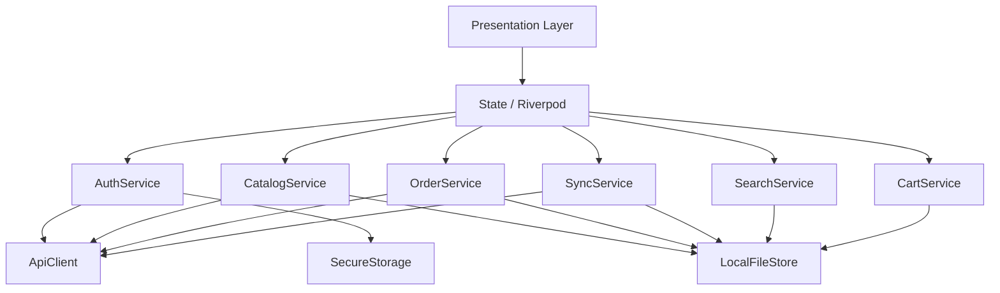

# Design Document: Flutter POS App

## Overview

The Flutter POS App is a cross-platform mobile application for Android and iOS that replicates the customer-facing flow of an existing ASP.NET Web Forms POS system. Customers use the app to browse a product catalog (organized into categories → groups → items), manage a shopping cart, place orders, and review order history.

The app communicates with the existing ASMX web service backend (`appservice.asmx`) over HTTPS, uses token-based authentication stored persistently on the device, and supports full offline browsing via a pre-bundled and incrementally synchronized local file store.

### Key Design Goals

- **Offline-first**: The app must be immediately usable after install with pre-bundled data; network access only enriches data, never blocks browsing.
- **Append-only sync**: Local catalog data is never overwritten — only new records appended — to preserve reliability under partial connectivity.
- **Persistent authentication**: Token stored in platform secure storage, no expiration, no forced re-login unless the customer explicitly logs out.
- **Exact behavior parity**: Color-coding, price tier resolution, image dimensions, and error messages replicate the existing web application exactly.

---

## Architecture

The application follows a layered architecture aligned with Flutter best practices:

```
┌────────────────────────────────────────────────────────┐
│                    Presentation Layer                   │
│  (Flutter Widgets / Screens / Navigation)               │
├────────────────────────────────────────────────────────┤
│                  State Management Layer                  │
│  (Riverpod providers / Notifiers)                        │
├────────────────────────────────────────────────────────┤
│                   Domain / Use-Case Layer                │
│  (AuthService, CatalogService, CartService,              │
│   OrderService, SyncService, SearchService)              │
├──────────────────────────┬─────────────────────────────┤
│    Remote Data Source     │   Local Data Source         │
│  (ApiClient → ASMX)      │  (LocalFileStore / Assets)  │
└──────────────────────────┴─────────────────────────────┘
```

### State Management

**Riverpod** is used throughout for reactive state management. Each domain service is exposed as a `Provider` or `AsyncNotifierProvider`, giving widgets fine-grained access to state without tight coupling.

### Navigation

**go_router** handles declarative navigation with route guards. On cold start, the router reads the auth state from `AuthService` and redirects to `/login` or `/home` accordingly.

### Local Storage

Local catalog data is stored as JSON files in the app's documents directory, organized as:

```
<documents>/
  catalog/
    categories.json
    groups/
      <category_id>.json
    items/
      <category_id>_<group_id>.json
    item_details/
      <item_id>.json
    price_tiers/
      <item_id>.json
  images/
    categories/
    groups/
    items/
  orders/
    queue.json        ← offline order queue
  sync_meta.json      ← last sync timestamps per data type
```

Pre-bundled default data and images are included in the Flutter assets bundle and copied to the documents directory on first launch if local files do not already exist.

### Dependency Graph (simplified)



---

## Components and Interfaces

### 1. ApiClient

Thin HTTP wrapper around the ASMX web service. All requests include the stored token as a query or header parameter.

```dart
abstract class ApiClient {
  Future<String> checkToken(String token);
  Future<String> login(String username, String password);
  Future<List<CategoryDto>> getCategories();
  Future<List<GroupDto>> getGroups(int categoryId);
  Future<List<ItemDto>> getSaleItems(int categoryId, int groupId);
  Future<ItemDetailDto> getItemDetail(int itemId);
  Future<List<PriceTierDto>> getItemUnits(int itemId);
  Future<OrderResultDto> submitOrder(OrderPayloadDto payload);
  Future<List<OrderDto>> getOrders(int customerId);
  Future<String> expireToken(String token);
  Future<String> getImageUrl(String imagePath, int width, int height);
}
```

Timeout: 30 seconds on every request. On timeout or network error the client throws a typed `ApiException` that the domain layer handles.

### 2. AuthService

Manages the full authentication lifecycle.

```dart
abstract class AuthService {
  Future<AuthResult> login(String username, String password);
  Future<bool> validateStoredToken();
  Future<void> logout();
  String? get currentToken;
  int? get currentUserId;
}
```

- On `login`: calls `ApiClient.login`, receives token, stores it via `flutter_secure_storage`.
- On app start: reads token from secure storage → calls `ApiClient.checkToken` → navigates accordingly.
- On `logout`: calls `ApiClient.expireToken`, deletes token from secure storage, clears cart from local store.

### 3. CatalogService

Handles category, group, and item retrieval using the offline-first strategy.

```dart
abstract class CatalogService {
  Future<List<Category>> getCategories();
  Future<List<Group>> getGroups(int categoryId);
  Future<List<Item>> getItems(int categoryId, int groupId);
  Future<ItemDetail> getItemDetail(int itemId);
  Future<List<PriceTier>> getPriceTiers(int itemId);
}
```

Read strategy for every method:
1. Attempt to load from `LocalFileStore`.
2. If local file exists and is non-empty, return local data immediately.
3. In the background (or if the device is online), fetch from `ApiClient`.
4. For any records not already present locally, append them to the local file.

### 4. CartService

In-memory + persisted cart state. Cart contents survive app restarts via a local JSON file.

```dart
abstract class CartService {
  List<CartItem> get items;
  double get total;
  void addItem(Item item);
  void setQuantity(int itemId, int quantity);
  void removeItem(int itemId);
  void clear();
  int quantityFor(int itemId);
  PriceTier resolvePrice(int itemId, int quantity, List<PriceTier> tiers);
}
```

`resolvePrice` is a **pure function** — it takes quantity and the ordered list of tiers, returns the applicable tier. This is the primary candidate for property-based testing.

### 5. OrderService

Manages order submission and history retrieval.

```dart
abstract class OrderService {
  Future<OrderResult> placeOrder(int customerId, List<CartItem> items);
  Future<List<Order>> getOrderHistory(int customerId);
  Future<void> queueOfflineOrder(OrderPayload payload);
  Future<void> flushOfflineQueue();
}
```

When offline, orders are appended to `orders/queue.json`. `flushOfflineQueue` is called on reconnection.

### 6. SearchService

Executes client-side searches against locally stored catalog data.

```dart
abstract class SearchService {
  Future<List<Item>> search(String query);
}
```

- Minimum 2 characters before executing.
- Case-insensitive partial match on `ItemName` and `ItemCode`.
- Reads from `LocalFileStore` only — no network call.

### 7. SyncService

Orchestrates background incremental synchronization.

```dart
abstract class SyncService {
  Future<void> synchronize();
  DateTime? get lastSyncedAt;
}
```

- Reads `sync_meta.json` for last sync timestamps.
- Requests only data newer than the last timestamp from the backend.
- Appends new records to local files; never overwrites existing entries.
- Updates `sync_meta.json` on success.

### 8. LocalFileStore

Abstracts all JSON file I/O.

```dart
abstract class LocalFileStore {
  Future<List<T>> readList<T>(String path, T Function(Map) fromJson);
  Future<void> appendItems<T>(String path, List<T> newItems, 
      String Function(T) idKey, T Function(Map) fromJson, Map Function(T) toJson);
  Future<void> writeList<T>(String path, List<T> items, Map Function(T) toJson);
  Future<void> copyAssetIfAbsent(String assetPath, String localPath);
}
```

`appendItems` is the key method: it reads existing records, determines which new items have IDs not already present, and appends only those.

### 9. ImageHandler

Manages image loading priority: local → remote → placeholder.

```dart
abstract class ImageHandler {
  Widget buildImage(String imagePath, int width, int height, {Widget? placeholder});
  Future<void> preloadBundledImages();
}
```

Uses `cached_network_image` for remote images with local file system as the first-priority cache. Images are stored at `<documents>/images/<type>/<id>.<ext>`.

---

## Data Models

### Domain Models

```dart
class Category {
  final int categoryId;
  final String categoryName;
  final String imageUrl;
  final int colorIndex;       // 0–20, maps to color array
}

class Group {
  final int groupId;
  final int categoryId;
  final String groupName;
  final String imageUrl;
}

class Item {
  final int itemId;
  final int categoryId;
  final int groupId;
  final String itemName;
  final String itemCode;
  final String imageUrl;
  final double price;         // lowest tier / display price
}

class ItemDetail {
  final int itemId;
  final String itemName;
  final String itemCode;
  final String imageUrl;
  final List<PriceTier> priceTiers;
}

class PriceTier {
  final int saleId;
  final int itemId;
  final int fromQty;
  final int toQty;            // 0 = unlimited
  final double priceUsd;
  final double priceKhr;      // priceUsd × exchange rate
}

class CartItem {
  final int itemId;
  final String itemName;
  final String itemCode;
  int quantity;
  double unitPriceUsd;
  double unitPriceKhr;
  int appliedSaleId;
}

class Order {
  final int orderId;
  final int customerId;
  final String invoiceNo;
  final DateTime createdDate;
  final double total;
  final bool deleted;
}

class OrderDetail {
  final int orderId;
  final int itemId;
  final String itemName;
  final String itemCode;
  final int quantity;
  final double unitPrice;
  final double lineTotal;
}
```

### DTO Models (ASMX Response Mapping)

The ASMX service returns HTML strings for some endpoints (e.g., `getGroup`, `getSaleItem`) and JSON for others. The `ApiClient` implementation parses both formats into typed DTOs before they reach the domain layer.

For endpoints that return JSON:
```dart
class CategoryDto {
  final int categoryId;
  final String categoryName;
  final String imageUrl;
  // fromJson / toJson
}
// Similar DTOs for GroupDto, ItemDto, PriceTierDto, OrderDto, OrderDetailDto
```

### Color Array

Exact 21-color array from the backend, used for category and group card backgrounds:

```dart
const List<String> kCategoryColors = [
  '#04478a', '#8a040a', '#8a045b', '#6f048a', '#31048a',
  '#04148a', '#045f8a', '#048a71', '#048a27', '#3e8a04',
  '#888a04', '#8a4804', '#8a1704', '#b32020', '#b32071',
  '#9620b3', '#3d20b3', '#2068b3', '#20b3a5', '#20b339',
  '#4bb320',
];

Color colorForIndex(int index) =>
    Color(int.parse(kCategoryColors[index % 21].replaceFirst('#', '0xFF')));
```

### Sync Metadata

```dart
class SyncMeta {
  final DateTime? categoriesLastSync;
  final DateTime? groupsLastSync;
  final DateTime? itemsLastSync;
  final DateTime? imagesLastSync;
  // fromJson / toJson
}
```

---

## Correctness Properties

*A property is a characteristic or behavior that should hold true across all valid executions of a system — essentially, a formal statement about what the system should do. Properties serve as the bridge between human-readable specifications and machine-verifiable correctness guarantees.*

### Property 1: Price tier selection is deterministic and correct

*For any* positive integer quantity and any non-empty list of price tiers, `resolvePrice` SHALL return the tier whose `fromQty ≤ quantity ≤ toQty` (where `toQty = 0` is treated as unlimited), and the result SHALL be the tier with the highest matching `fromQty`.

**Validates: Requirements 6.6, 6.10**

### Property 2: Cart total equals sum of line totals

*For any* non-empty cart state (arbitrary items with arbitrary quantities and unit prices), the value returned by `CartService.total` SHALL equal the sum of `quantity × unitPriceUsd` for every item in the cart.

**Validates: Requirements 6.8, 19.7**

### Property 3: Search returns only matching items

*For any* query string of 2 or more characters and any locally stored item catalog, every item returned by `SearchService.search` SHALL have its `ItemName` or `ItemCode` contain the query string (case-insensitive partial match), and no item that matches SHALL be excluded from the results.

**Validates: Requirements 9.2, 9.3, 9.7**

### Property 4: Append-only sync never loses existing catalog data

*For any* existing local category/group/item list and any incoming list of records from the backend, after calling `LocalFileStore.appendItems`, every record that was present before the call SHALL still be present in the local file, and every incoming record with a new ID SHALL also be present.

**Validates: Requirements 3.4, 3.5, 10.3, 10.4, 18.4, 18.7**

### Property 5: Cart serialization round-trip is lossless

*For any* cart state (arbitrary items, quantities, and price data), serializing the cart to JSON and deserializing it SHALL produce a cart state equal to the original.

**Validates: Requirements 6.9, 19.2**

### Property 6: Adding an item increments its quantity by 1

*For any* cart state and any item, calling `CartService.addItem` SHALL increase the quantity of that item in the cart by exactly 1, and SHALL leave all other items unchanged.

**Validates: Requirements 6.1, 6.2**

### Property 7: Removing an item produces a cart without that item

*For any* cart state containing a given `itemId`, calling `CartService.removeItem(itemId)` SHALL result in a cart where `quantityFor(itemId) == 0` and the cart total reflects the removal.

**Validates: Requirements 6.7, 19.6**

---

## Error Handling

### Network Errors

All `ApiClient` calls are wrapped in try-catch. The service layer converts raw exceptions into typed results:

```dart
sealed class ServiceResult<T> {
  const factory ServiceResult.ok(T value) = Ok;
  const factory ServiceResult.networkError(String message) = NetworkError;
  const factory ServiceResult.authError() = AuthError;
  const factory ServiceResult.validationError(String message) = ValidationError;
  const factory ServiceResult.unexpectedError(String message) = UnexpectedError;
}
```

- **NetworkError**: shown as a snackbar; cached/local data continues to serve the UI.
- **AuthError** (token invalid): router redirects to `/login`.
- **ValidationError**: highlighted field + inline message (red border on login fields).
- **UnexpectedError**: logged to device log file + "An unexpected error occurred" toast.

### Offline Handling

- The `ConnectivityService` (wraps `connectivity_plus`) broadcasts the current connectivity state.
- All write operations that require network (order placement) check connectivity first and show "No internet connection. Please try again when online." if offline.
- Order payloads queued offline are persisted to `orders/queue.json`; on reconnection `SyncService` flushes the queue in FIFO order.

### Specific Error Messages

These messages are reproduced exactly from the backend:

| Condition | Message |
|---|---|
| Username not found | "User name is incorrect!" |
| Password mismatch | "Password is incorrect!" |
| Account locked | "Your user account has been locked! Please contact IT" |
| No internet at checkout | "No internet connection. Please try again when online." |
| Empty search results | "No items found" |
| Empty cart | "Your cart is empty" |

### Input Validation

- Login: username and password fields must be non-empty; empty field gets red border.
- Quantity inputs: must be positive integers; non-numeric or zero input is rejected.
- Search: minimum 2 characters required before querying.
- Token validation failure: immediate redirect to login screen.

---

## Testing Strategy

### Dual Testing Approach

Both unit/example tests and property-based tests are used. Property-based tests handle the business logic components with wide input variation; example-based tests cover specific scenarios, integration points, and UI flows.

### Property-Based Testing

**Library**: [`rapid_check`](https://pub.dev/packages/rapid_check) (Dart port of property-based testing, 100+ iterations per property).

Each property test is tagged with the design property it validates:

```dart
// Feature: flutter-pos-app, Property 1: Price tier selection is deterministic and correct
test('resolvePrice returns correct tier for all quantities', () {
  forAll(
    gen.combine2(gen.positiveInt, gen.listOf(priceTierGen)),
    (quantity, tiers) { /* ... */ },
  );
}, tags: ['property']);
```

Minimum **100 iterations** per property test. Property tests are isolated — they test pure functions and do not hit the network or file system.

### Unit Tests

Focus areas:
- `AuthService`: login success, wrong password, locked account, token validation, logout flow
- `CatalogService`: local-first read strategy (mock LocalFileStore), fallback to API, append logic
- `OrderService`: successful submission, offline queue, flush on reconnect
- `SearchService`: 2-char minimum, partial match, case-insensitivity, no-results path
- `ImageHandler`: local-first load, placeholder on failure, dimension resizing logic

### Widget Tests

- Login screen: field validation, error message display, loading state
- Category grid: color cycling, tap navigation
- Item grid: quantity badge visibility and update
- Cart view: line totals, grand total, remove button, empty state
- Order history: sort order, detail expansion

### Integration Tests

- Full login → browse → add to cart → checkout flow on a real device emulator
- Offline mode: disable network, verify browsing still works, verify checkout is blocked
- Sync: seed local data, mock backend with new records, verify append-only behavior
- Token expiry: invalidate token mid-session, verify redirect to login

### Performance Tests

- Scroll performance on item list with 200+ items (target: 60 fps)
- Catalog load from local files (target: < 500 ms)
- App cold-start time (target: < 3 seconds on mid-range device)
- Splash screen duration (target: ≤ 2 seconds)

### Accessibility

- All interactive elements have semantic labels for screen readers
- Touch targets are at minimum 48×48 logical pixels
- Contrast ratios meet WCAG AA for text on colored category backgrounds
